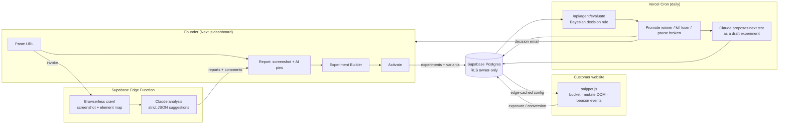
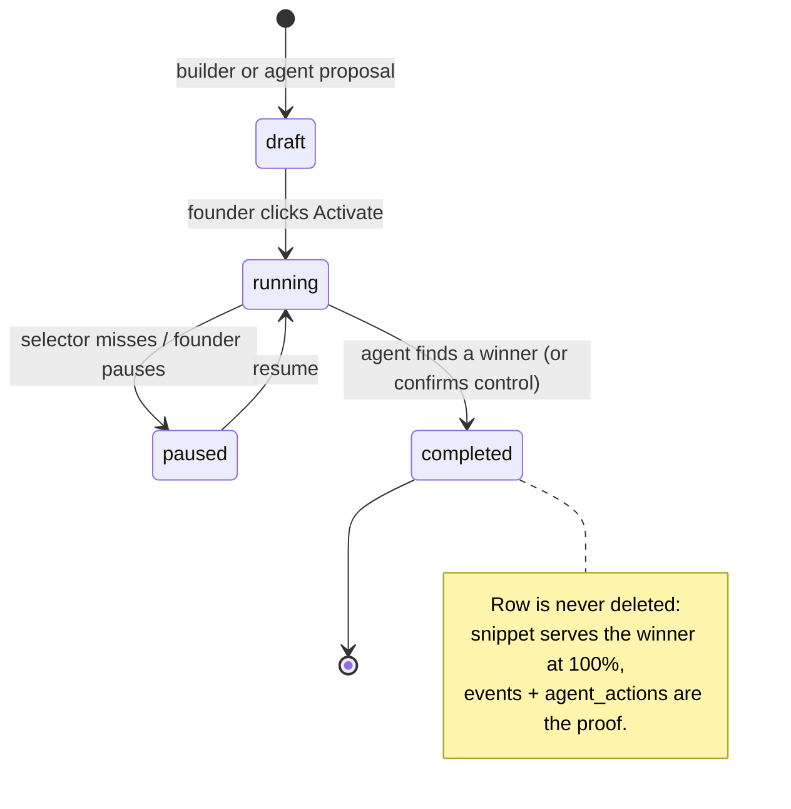

<p align="center">
  
</p>

<h1 align="center">Sitewide</h1>

<p align="center">
  <strong>Agentic A/B testing for SaaS founders.</strong><br />
  It tells you <em>what</em> to test, runs the test on your real visitors, calls the winner, and queues the next one.
</p>

<p align="center">
  
  
  
  
  
  
</p>

---

## What it does

Most A/B testing tools make you come up with the idea, build the variant, and babysit the stats. Sitewide collapses that into a loop:

1. **Analyze** — paste a URL. A headless browser crawls it, Claude reads the rendered page, and 8–10 concrete conversion suggestions get pinned onto a screenshot, each with ready-to-use variant copy.
2. **Build** — click any element on that screenshot, pick a change (text / style / image / hide) and a goal (click an element, or reach a page), submit. Or accept an AI suggestion in one click.
3. **Serve** — a zero-flicker JS snippet buckets real visitors into variants, mutates the DOM, and reports exposures and conversions.
4. **Decide** — a daily agent evaluates every running test with a Bayesian sequential rule, kills harmful variants, promotes winners (the snippet then serves the winner to 100% of traffic), and proposes the next test as a draft.

Built for PLG SaaS with ~10k–20k+ monthly visitors and no dedicated CRO person. Deliberately **not** an analytics product: no heatmaps, no funnels, no session replays.

## How data moves



**The five hops, briefly:**

| # | Step | Where | What happens |
|---|------|-------|--------------|
| 1 | Crawl + analyze | `supabase/functions/analyze-page/` | One Browserless call scrolls the page, screenshots it, and extracts up to 300 elements **from the same rendered DOM** so pixel boxes line up with the screenshot. Each element gets a unique `nth-of-type` selector plus a `{tag, text}` fallback. Claude returns strict JSON; element ids are resolved back to percentage coordinates so pins work at any screen size. |
| 2 | Build | `components/experiment-builder/`, `lib/experiments.ts` | A Figma-style canvas over the screenshot (no iframe, so CSP / X-Frame-Options can never break it). Selectors are lifted from the chosen element; the UI never touches them. Creates an `experiments` row plus one `experiment_variants` row per arm, control included. |
| 3 | Serve | `public/snippet.js`, `app/api/snippet/*` | A synchronous script in `<head>` ships with the site's config baked in (edge-cached ~30 s). Visitor id is a first-party cookie; bucketing is `hash(visitorId + experimentId) % 100`, so it is sticky with no server round-trip. A `MutationObserver` re-applies changes after React hydration and client-side navigation. |
| 4 | Track | `app/api/snippet/event` | Exposure and conversion events via `sendBeacon`. A unique index on `(experiment_id, visitor_id, event_type)` means the snippet fires naively and stats just count rows. Bots are filtered at the event, never at the apply, because serving bots a different page is cloaking. |
| 5 | Evaluate | `app/api/agent/evaluate`, `lib/stats.ts`, `lib/propose.ts` | Perceive → decide → act → remember. Every decision and its reasoning lands in `agent_actions`, an audit trail the founder reads in the Activity tab. Heartbeat rows per run detect a silently dead cron. |

## Experiment lifecycle



## Statistics

The agent peeks at every experiment once a day, which breaks a fixed-horizon z-test. `lib/stats.ts` uses **Beta–Binomial posteriors on unique visitors** and acts only when both hold:

- the variant is ≥ 95% likely to beat control, **and**
- the expected cost of being wrong is ≤ 0.05% of control's conversion rate.

The risk cap is what makes daily peeking safe: on thin data it effectively demands ~99.7% confidence and relaxes toward 95% as the posterior tightens. A circuit breaker kills a variant with ≤ 1% chance of winning once both arms clear 150 exposures. The dashboard reuses the exact same function and thresholds as the agent, so the UI and the agent can never disagree about whether a result exists. Verified against Monte Carlo and daily-loop A/A simulations in `scripts/test-bayes-stats.ts`.

## Features

- **Cold-start AI analysis** — useful with zero historical traffic; suggestions come from the page, not from past data.
- **Screenshot-based builder** — click-to-select with innermost-element hover, per-tag change types, click or pageview goals, and an honest "will this test ever finish?" estimator.
- **Zero-flash variant serving** — element-scoped anti-flicker, deterministic bucketing, SPA-aware (wraps `pushState`), self-reporting selector misses.
- **Autonomous agent** — daily evaluation, harm gate, winner promotion, next-test proposal (Claude with structured outputs), decision emails and a Monday digest via Resend.
- **PostHog context** — optional read-only connector so Claude weights suggestions by real traffic. Agent context only; never a goal or a denominator.
- **Security defaults** — owner-only RLS on every table, service role only in server routes, UUID validation + per-IP rate limits + Origin checks on the public event endpoint, API keys stored in a zero-policy table.

## Stack

| Layer | Choice | Why |
|-------|--------|-----|
| App | Next.js 16 (App Router), React 19, TypeScript, Tailwind 4 | One codebase for dashboard + API routes; deploys to Vercel with cron. |
| Data / auth | Supabase (Postgres, Auth, Storage, Edge Functions) | RLS does authorization for free; edge functions get 150 s for the crawl vs Vercel's 10 s. |
| Crawling | Browserless | Real Chrome rendering; Playwright can't run on Vercel's free tier. |
| AI | Claude via `@anthropic-ai/sdk` | Page analysis (edge fn) and next-test proposals (structured outputs). |
| Snippet | Vanilla JS, no deps | Must be tiny and sync-in-head; runs on sites we don't control. |
| Email | Resend | Decision + digest emails. |

## Repository layout

```
app/
  dashboard/(shell)/        experiments · analyses · analytics · activity · settings
  dashboard/report/[id]/    report view (screenshot + pins) and /builder
  api/snippet/              js/[siteId] (served snippet) · config · event
  api/agent/                evaluate · propose · digest · sync-analytics · status
  api/{report,account}/     service-role deletes (screenshots + comments don't cascade)
components/                 dashboard/ · experiment-builder/ · report/ · graph/ · homepage/
lib/                        all DB access + logic as pure async fns
  stats.ts                  Bayesian decision rule + circuit breaker
  propose.ts                "what to test next" (Claude)
  experiments.ts reports.ts snippetConfig.ts snippetGuards.ts botFilter.ts posthog.ts
public/snippet.js           the visitor-side runtime
supabase/functions/analyze-page/   crawl + analysis pipeline (Deno)
scripts/                    simulation + integration tests (no test runner needed)
```

## Key design decisions

| Decision | Rationale |
|----------|-----------|
| Screenshot + bounding boxes instead of an iframe | Iframes fail on exactly the sites we target (CSP, X-Frame-Options). The crawl already gives aligned pixels + DOM. |
| `nth-of-type` paths anchored at the nearest `#id` | Unique by construction and immune to Tailwind class churn like `text-[22px]`. |
| Experiment-scoped tracking, two event types | ~1–2% of an analytics product's event volume, so Postgres suffices and "unlimited tests" pricing is structurally cheap. |
| Dedupe via DB unique index, not code | The snippet can be naive and stats can count rows. No dedup logic anywhere. |
| Bayesian sequential over fixed-horizon z-test | The agent checks daily; the risk-capped rule stays honest under repeated looks and removes the "expected lift" question founders couldn't answer. |
| Winner promotion = runtime mutation at 100% | Closing the loop needs no founder action; they paste the winning copy into code whenever they like. |
| Claude proposes, never activates | Statistics decides winners; a human approves every new test. |

## Running locally

```bash
npm install
npm run dev     # http://localhost:3000
```

Create `.env.local` with:

| Variable | Used by |
|----------|---------|
| `NEXT_PUBLIC_SUPABASE_URL`, `NEXT_PUBLIC_SUPABASE_PUBLISHABLE_KEY` | client (RLS) |
| `SUPABASE_SERVICE_ROLE_KEY` | server routes only |
| `AGENT_SECRET`, `CRON_SECRET` | manual / cron auth for `/api/agent/*` |
| `AGENT_PROPOSE_MODEL`, `ANALYZE_MODEL` | Claude model overrides (optional) |
| `RESEND_API_KEY`, `EMAIL_FROM`, `APP_URL` | emails |

The analysis pipeline runs as a Supabase edge function (`supabase functions serve analyze-page`) and needs Browserless + Anthropic keys in its own secrets.

Run the agent by hand instead of waiting for the 09:00 UTC cron:

```bash
curl -X POST http://localhost:3000/api/agent/evaluate -H "authorization: Bearer $AGENT_SECRET"
```

Pure tests that need no server or database:

```bash
node scripts/test-bayes-stats.ts     # decision rule vs Monte Carlo + A/A daily-peek simulation
node scripts/test-snippet-guards.ts  # endpoint validation / origin checks
node scripts/test-snippet.mjs        # snippet behaviour under jsdom
```

## Further reading

- [`app_explanation.md`](app_explanation.md) — full reference for every subsystem and the decisions behind it.
- [`agent_loop.md`](agent_loop.md) — the experiment lifecycle and the agent's exact decision rules, with timings.
